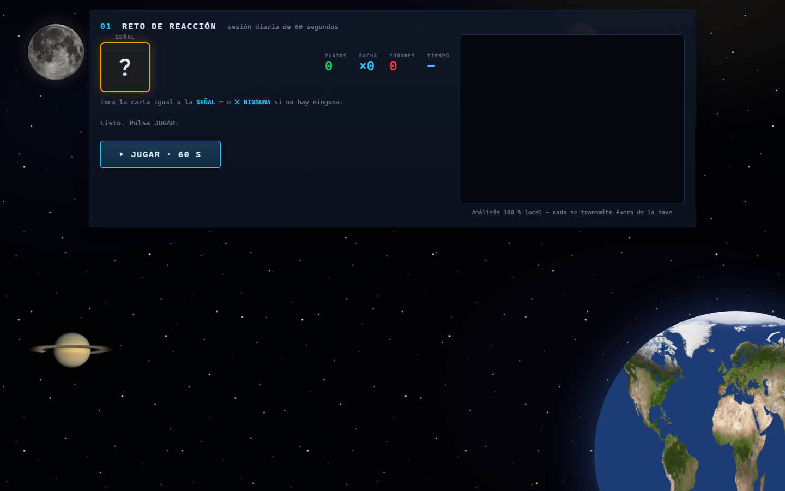

# ASTRO-TRIAGE

**Invisible Health Copilot for Astronauts** — NASA Space Apps Challenge 2026

> The astronaut doesn't take a medical exam. They play 60 seconds of a card game — and the ship evaluates their health on its own.



## The problem

On long-duration missions (Mars-class), the nearest physician is ~20 light-minutes away. Crew members must self-assess — but current cognitive tests (PVT-style) are tedious, so they get postponed, and problems are discovered late.

## The idea

Hide the daily health check inside something the crew *wants* to do: a 60-second reaction card game. While they play, passive camera biometrics and gameplay performance are collected in the background. An offline triage engine then issues a color-coded operational verdict with concrete countermeasures — citing real NASA protocols.

## How it works

```
JUGAR / PLAY  ──► 60 s card game (visible)
                   ├─ gameplay: latency, >500 ms lapses, error rate (PVT-equivalent)
                   └─ camera (invisible): 12 passive biomedical signals
AUTO FLOW    ──► 3-tap check-in: mood · sleep · crew morale + optional symptoms
VERDICT      ──► NOMINAL / VERDE / ÁMBAR / ROJO
                   + findings in plain language
                   + up to 3 actions citing NASA-STD-3001 / IMG / BHP protocols
                   + 14-day personal baseline trend + 4-7-8 breathing when needed
```

**Everything runs on board. Zero bytes transmitted.**

## Features

- **Reaction card game (60 s)** — match the SIGNAL card or ✕ NONE. Measures latency, lapses and errors like a PVT without feeling like a test.
- **Passive camera biometrics** — blink rate/duration, PERCLOS, yawns, facial asymmetry (neuro alert), EAR asymmetry, head sway, rPPG heart rate, HRV stress, gaze-away, face tension, sclera redness.
- **3-tap emotional check-in** — mood, sleep, crew connection, plus optional symptom taps (headache, dizziness, nausea).
- **Autonomous triage engine** — signal-convergence algorithm (IMG-9.1 style): severity × domain findings, composite patterns, 4 operational levels.
- **18 indexed protocols** — NASA-STD-3001, IMG checklists and behavioral-health (BHP) docs, cited in every recommended action.
- **Personal baseline** — each astronaut is compared against their own history (the NASA standard), with a 14-day trend.
- **4-7-8 breathing intervention** — offered automatically when stress or ÁMBAR/ROJO is detected.
- **Verdict voice-out** — one-tap speech synthesis.
- **Degraded mode** — no camera? falls back to game + check-in. Nothing at all? conservative simulated values. The crew always gets an answer.
- **Jury mode** — `Alt+Shift+1 / 2 / 3` injects NOMINAL / ÁMBAR / ROJO scenarios for demos.
- **Real space scene** — rotating Earth (NASA Blue Marble), Moon, Mars, Saturn and Eros asteroid imagery, all served locally.
- **Offline-first** — no external services required; optional Ollama for narrated verdicts, optional Qdrant for the vector store.

## Quickstart

```powershell
# Windows
powershell -File run.ps1

# Linux / macOS / Git Bash
bash run.sh
```

Open **http://127.0.0.1:8000** → press **▸ JUGAR · 60 s** → the rest happens automatically.

## Architecture

```
frontend/ (served by the same backend)
  index.html  console UI — real NASA photo scene, single JUGAR action
  game.js     card game → latency / lapses / error rate (PVT-equivalent)
  camera.js   MediaPipe FaceMesh + rPPG → 12 passive bio signals (in-browser)
  app.js      orchestration, signals panel, check-in, verdict, trend, voice
  style.css   instrument-console theme + animated space scene
  assets/     local real imagery (earth, moon, mars, saturn, eros)

backend/ (FastAPI, single process)
  main.py      /api/status · /api/protocols · /api/assessment
  triage.py    signal convergence → findings, composites, triage level
  retriever.py local semantic search (memory store; Qdrant if available)
  narrator.py  deterministic action card (Ollama llama3.1 if available)
  data/protocols.json  18 NASA-style medical protocols
```

### Optional hybrid mode

```bash
docker run -p 6333:6333 qdrant/qdrant     # real vector store
ollama serve && ollama pull llama3.1       # local LLM narrator
```

Env vars `QDRANT_URL`, `OLLAMA_URL`, `OLLAMA_MODEL` point to other hosts.

## API

- `GET /api/status` — mode, indexed protocols, earth-link status
- `GET /api/protocols` — indexed corpus
- `POST /api/assessment` — metrics JSON → `{triage_level, findings, composites, action_card, sources, generated_by}`

```bash
curl -X POST http://127.0.0.1:8000/api/assessment \
  -H "Content-Type: application/json" \
  -d '{"blink_rate":9,"latency_delta_pct":18,"error_rate":0.24,"lapse_count":5,"hr_bpm":88,"facial_asymmetry":0.08,"head_sway":0.3,"psych_answers":["mood:bajo","sleep:mal"],"notes":"sintomas: cefalea"}'
```

## Docs (in `docs/`)

| File | Contents |
|---|---|
| `ASTRO-TRIAGE_DECK.pdf` | 10-slide landscape deck (presentation) |
| `ASTRO-TRIAGE_DOSSIER.pdf` | 15-page detailed dossier |
| `RESUMEN_ASTRO-TRIAGE.pdf` | Full feature inventory (3 pages, ES) |
| `PITCH_V1–V5.pdf` | Five alternative pitch designs |
| `ANALISIS.md` | Technical analysis (ES) |

## Resumen en español

Copiloto de salud invisible para astronautas: un juego de cartas de 60 segundos que, mientras se juega, captura 12 señales biomédicas por cámara y el rendimiento del propio juego. Un motor de triaje local cruza las señales contra la línea base personal del astronauta, consulta 18 protocolos NASA y responde con un color y tres acciones — todo a bordo, sin internet, sin transmitir ni un byte.

## License

MIT — see [LICENSE](LICENSE).
